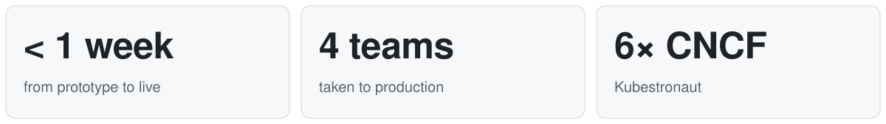
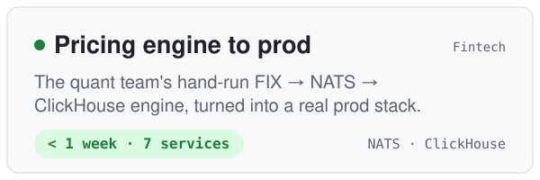
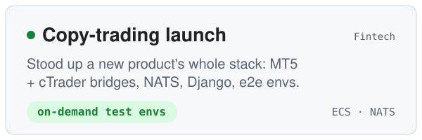
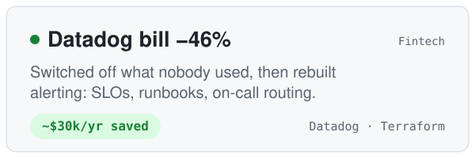
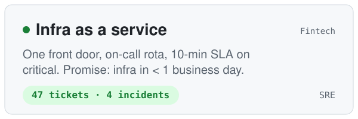
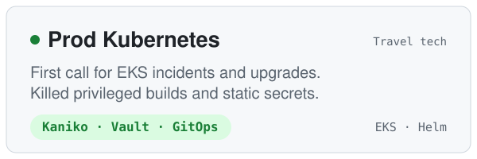
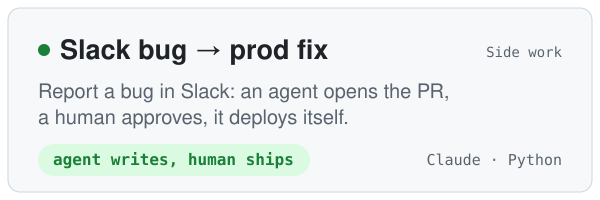

<picture><source media="(prefers-color-scheme: dark)" srcset="assets/cover-dark.svg"></picture>

I get dropped into messy production systems, work out what the team actually needs, and leave behind infrastructure they can trust. I've built platforms for trading, risk, support and data teams in regulated fintech.

<picture><source media="(prefers-color-scheme: dark)" srcset="assets/numbers-dark.svg"></picture>

### Selected work

<picture><source media="(prefers-color-scheme: dark)" srcset="assets/projects/pricing-dark.svg"></picture><picture><source media="(prefers-color-scheme: dark)" srcset="assets/projects/support-dark.svg"></picture><picture><source media="(prefers-color-scheme: dark)" srcset="assets/projects/copytrading-dark.svg"></picture><picture><source media="(prefers-color-scheme: dark)" srcset="assets/projects/datadog-dark.svg"></picture><picture><source media="(prefers-color-scheme: dark)" srcset="assets/projects/outage-dark.svg"></picture><picture><source media="(prefers-color-scheme: dark)" srcset="assets/projects/service-dark.svg"></picture><picture><source media="(prefers-color-scheme: dark)" srcset="assets/projects/k8s-dark.svg"></picture><picture><source media="(prefers-color-scheme: dark)" srcset="assets/projects/agent-dark.svg"></picture>

### Stack

Plus Datadog · NATS JetStream · ClickHouse · Spacelift · Helm · ArgoCD · Vault

&nbsp;

[LinkedIn](https://linkedin.com/in/qais-navaei) &nbsp;·&nbsp; [Email](mailto:qaisbaraki81@gmail.com)
